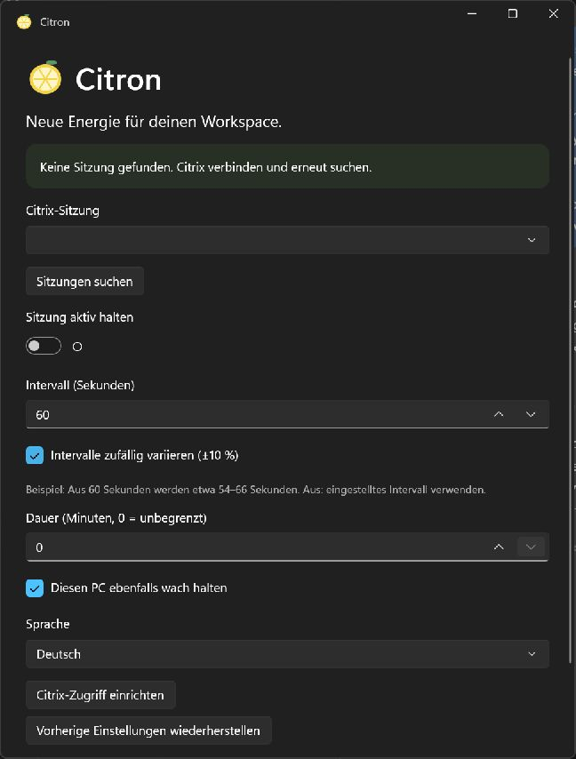

<div align="center">


# 🍋 Citron

### A little energy for your workspace.

A compact, multilingual Windows tray companion for Citrix sessions.

**WinUI 3 · One EXE · 5 languages · Windows x64 · Experimental preview**

[Download v0.2.1](https://github.com/Xploder/Citron/releases/tag/v0.2.1) · [Build from source](#-build-it-yourself) · [Validation](docs/VALIDATION.md)



</div>

---

## ✨ Small app. Focused purpose.

Citron is a native Windows utility designed to send periodic input directly to a selected Citrix session through the ICA Client Object / CCM interface. It does not use local keyboard injection or switch the foreground window to Citrix.

**Minimized-session delivery remains environment-dependent and has not yet passed end-to-end acceptance testing.** A successful API call is not proof that a remote idle timer was reset. Citrix versions, installation variants, and server policies affect compatibility.

## 🧩 Features

| | What you get |
| --- | --- |
| 🎯 Session selection | Choose one detected Citrix session rather than broadcasting to every session |
| 🍋 System tray | Double-click to enable/pause; right-click for quick actions |
| ⏱️ Timing | Adjustable interval and optional duration limit |
| 🖥️ Local wake option | Optionally prevent automatic sleep on this PC without local key presses |
| 🔐 Guided setup | Review the required registry values, approve UAC, and restore previous settings later |
| 🌍 Five languages | English, German, Spanish, French, and Portuguese |
| 🪟 Native UI | WinUI 3, custom title bar, Mica backdrop, and app/tray icons |
| 🧯 Process isolation | A stuck Citrix call times out after 12 seconds instead of freezing the UI |
| 📦 Portable download | One compressed executable with its runtime, assets, notices, and both helper architectures bundled |

## 🚀 Getting started

1. Download **Citron.exe** from [Releases](https://github.com/Xploder/Citron/releases/tag/v0.2.1).
2. Run it from a folder you can keep permanently. No separate .NET 10 or Windows App Runtime installation is needed.
3. On first launch, review **Set up Citrix access**. Approve the Windows UAC prompt if setup is required.
4. Connect a session using the native Citrix Workspace client, then select **Find sessions**.
5. Select the target, choose an interval/duration, and turn on **Keep session active**.

Citron always starts paused. Closing the settings window keeps it in the tray; **Quit** exits completely. A second launch brings the existing instance forward.

### Requirements

- Windows x64, Windows 10 version 1809 or later / Windows 11.
- Native Citrix Workspace with a registered ICA Client Object component. HTML5/browser-only sessions and the Microsoft Store SDK variant are not supported by this backend.
- .NET Framework 4.7.2 or newer for the tiny Citrix helpers. This is part of the supported Windows baseline; see [Microsoft's version table](https://learn.microsoft.com/en-us/dotnet/framework/install/versions-and-dependencies).
- Administrator approval only when changing the machine-wide Citrix setup values. The ordinary UI and simulation helpers run unelevated.

## ⚙️ What the settings do

- **Interval:** time between attempts, from 15 to 3,600 seconds.
- **Vary intervals randomly (±10%):** optional and off by default. Each next gap gets a fresh random value; 60 seconds becomes approximately 54–66 seconds. The configured base interval stays unchanged. Turning this off uses the configured interval without intentional variation. Windows scheduling and the one-second polling timer can still introduce small timing delays. This option makes no claim about monitoring-tool classification.
- **Duration:** automatically pause after the selected number of minutes; 0 means unlimited.
- **Also keep this PC awake:** prevents automatic local system sleep while enabled. It does not keep the display on, prevent Windows locking, or create local keyboard/mouse activity.
- **Language:** follows the Windows display language initially, falls back to English, and saves your manual selection immediately.

Windows locking pauses simulation and releases the local power request. Unlocking resumes only if the app remains enabled and the duration has not expired. Disconnects or failed calls pause activity with an error.

## 🔐 Transparent first-run setup

Citron checks `AllowLiveMonitoring` and `AllowSimulationAPI` under:

```text
HKLM\SOFTWARE\Citrix\ICA Client\CCM
```

The registry view matches the detected Citrix COM component. On x64 Windows, the 32-bit view appears under `WOW6432Node`.

Setup displays current values, requests UAC approval, saves previous values under `HKLM\SOFTWARE\Citron\RegistryBackup` in the same view, and sets the two DWORD values to `1`. Cancelling the review dialog makes no changes. Restoration preserves externally changed settings rather than overwriting them. Citrix updates may reset the values; refresh checks them again. Citron does not automatically terminate Workspace to apply changes.

## 📦 Why the download is smaller

The original prototype shipped **433 MiB across 1,160 files**. This release bundles the application into a single executable of approximately **34 MiB**, around **92% smaller** by download size.

The build uses the focused WinUI NuGet package, partial .NET trimming, native tray integration instead of Windows Forms, source-generated settings serialization, and single-file compression. The architecture-specific helpers use Windows' existing .NET Framework, avoiding two additional runtime distributions.

On launch, bundled runtime files, helper executables, assets, and dependency notices are extracted under Windows' `.net` temporary cache and reused. **One downloadable EXE does not mean zero extracted files or a 34 MiB installed footprint.** Old-version caches can consume additional disk space. User settings and diagnostic startup logs are stored in `%LOCALAPPDATA%\Citron`.

## 🛠️ Build it yourself

Install the **.NET 10 SDK** on Windows x64. Build tools and .NET Framework reference assemblies are restored through NuGet.

```powershell
.\build.ps1
.\verify.ps1
dotnet run --project .\tests\Citron.Timing.Tests -c Release
```

The portable output is `dist\portable\Citron.exe`. The build verifies that this directory contains exactly one file. Both x86 and x64 helpers are embedded automatically. Use a fresh output directory when switching packaging formats.

Optional build parameters:

```powershell
.\build.ps1 -DotnetPath 'C:\path\to\dotnet.exe' -OutputDirectory '.\dist\custom'
# Restricted build hosts that cannot create MSBuild task-host pipes:
.\build.ps1 -InProcessTasks
```

`verify.ps1` checks helper architectures, registry reads, refusal of unconfigured session access, and the one-file distribution. It never sets registry values or sends keys. See the [acceptance protocol](docs/VALIDATION.md) for live Citrix and tray checks.

## 🔬 Compatibility and limitations

Citron sends F15 key-down/key-up through the selected Citrix session object. F15 is not universally side-effect-free: remote applications, including terminals, can react to it. This does not unlock a locked desktop, reconnect a disconnected session, or override an absolute server session-duration policy.

The ICA/CCM approach was identified from [Andy Morgan's CaffeineForCitrixWorkspace](https://github.com/andyjmorgan/CaffeineForCitrixWorkspace). No binaries or source files from that repository are bundled. The native tray implementation is adapted from our Luma project.

## 🤖 Built with Codex

Citron is an AI-assisted project built with ChatGPT/Codex and reviewed through real Windows builds and UI checks. Commits created for this project use `ChatGPT <chatgpt@openai.com>` as author metadata; this is not a verified GitHub identity or an endorsement by OpenAI.

Development, GitHub documentation, and release notes are in English. The application itself is multilingual. This repository remains private during development.

Dependency license texts and notices are in [docs/licenses](docs/licenses) and are embedded in the executable.
